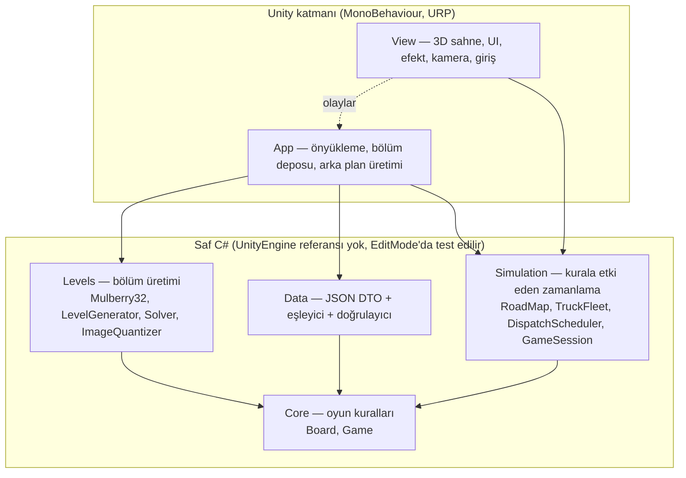
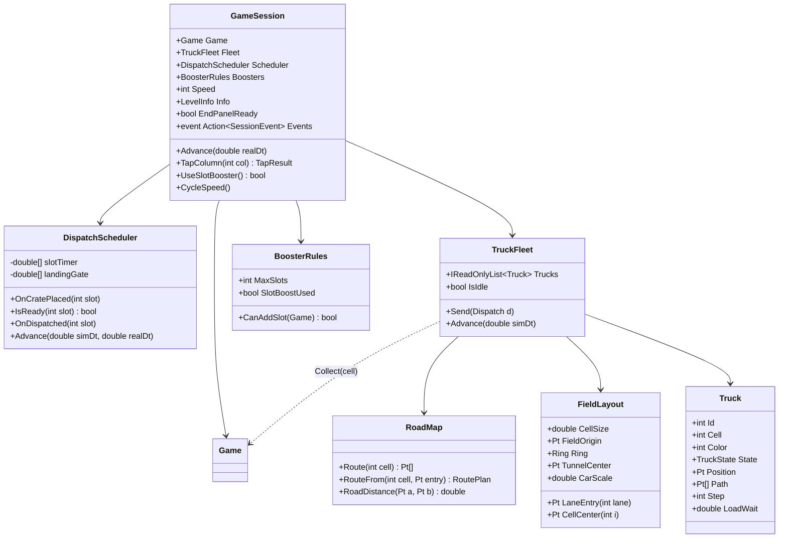
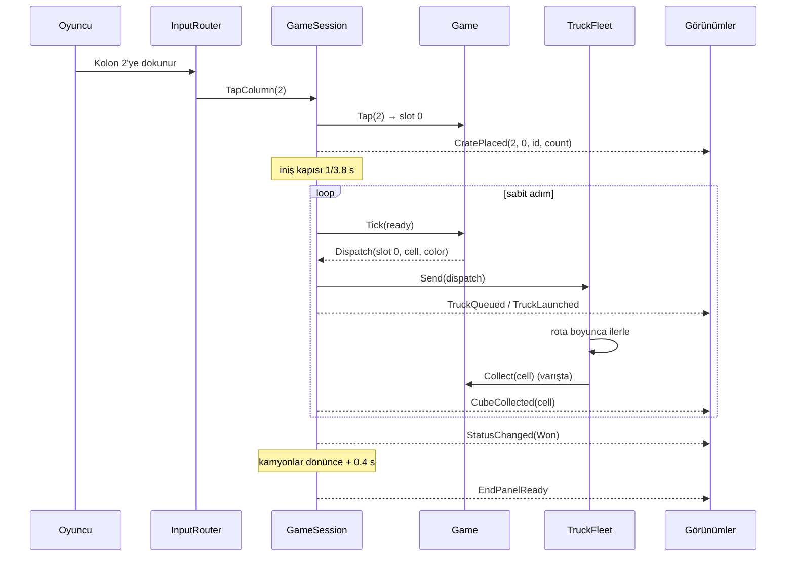

# CubeHaul3D — Taşıma Planı (TypeScript → Unity 6.3 LTS / C#)

| | |
|---|---|
| **Kaynak** | [yunusemreerinc/cube-hunt](https://github.com/yunusemreerinc/cube-hunt), `main` @ `559dfd90977b1e15367bd7de25aec9fbae4b52f6` (15.11.2026) |
| **Hedef** | CubeHaul3D — Unity 6.3 LTS (6000.3.x), Universal 3D (URP) şablonu, C# |
| **Platformlar** | Android, iOS (dikey ekran, dokunmatik) |
| **Bu belgenin kapsamı** | Analiz, katman ayrımı, C# mimari tasarımı, test planı, JSON bölüm formatı, riskler |
| **Kapsam dışı (bu aşamada)** | C# kodu, Unity projesi, 3D sahne. TypeScript projesine dokunulmaz. |

Planın tamamı, kaynak koddaki davranışın **bire bir korunması** ilkesine dayanır: C# çekirdeği aynı tohumla (seed)
aynı tepsiyi üretmeli, aynı hamle dizisinde aynı kamyonları aynı küplere göndermeli ve aynı anda kazanmalı ya da
tıkanmalıdır. 3D görselleştirme bu çekirdeğin üzerine, kuralları etkilemeyecek şekilde oturur.

### Alınan kararlar

| Konu | Karar | Etkisi |
|---|---|---|
| Proje adı | **CubeHaul3D** (depo adıyla aynı) | Unity projesi depo kökünde; asmdef/namespace önekleri `CubeHaul.*`; JSON `format` değerleri `cubehaul.*` |
| Kamera | **Ortografik** | Tüm küpler ekranda aynı boyda; okunabilirlik riski (R-17) azalır; derinlik hissi ışık ve eğik açıyla verilir (§3.5) |
| "Your image" | **İlk sürümde yok** | Galeri eklentisi, izinler ve çalışma zamanında bölüm üretimi v1 kapsamından çıktı (§2.3, §7) |

---

## İçindekiler

1. [Kaynak projenin analizi](#1-kaynak-projenin-analizi)
2. [Katmanların ayrılması: mantık, bölüm üretimi, görselleştirme](#2-katmanların-ayrılması)
3. [Unity C# sınıf mimarisi](#3-unity-c-sınıf-mimarisi)
4. [Davranışı korumak için test planı](#4-test-planı)
5. [Bölüm verisi için JSON formatı](#5-bölüm-verisi-için-json-formatı)
6. [Riskler ve önlemler](#6-riskler-ve-önlemler)
7. [Önerilen iş sırası](#7-önerilen-iş-sırası)
8. [Açık sorular](#8-açık-sorular)

Kararlar için başlıktaki [Alınan kararlar](#alınan-kararlar) tablosuna bakın.

---

## 1. Kaynak projenin analizi

### 1.1 Teknoloji ve yapı

- TypeScript 5.9, Vite 8 (tek HTML dosyasına gömülü derleme), Vitest 5. Çalışma zamanı bağımlılığı yok.
- Çizim: HTML Canvas 2D, sabit tasarım çözünürlüğü **420 × 900** (dikey), pencereye ölçeklenir.
- Arka plan iş parçacığı: Web Worker (bölüm üretimi).
- CI: GitHub Actions → `npm test` + `npm run build`.
- Taban çizgisi doğrulandı: `npx vitest run` → **2 dosya, 43 test, hepsi geçti** (Node 22).

| Dosya | Satır | Sorumluluk | Katman |
|---|---:|---|---|
| `src/core/types.ts` | 44 | `ColorId`, `OpenEdges`, `EMPTY`, `Picture`, `Block`, `Level`, `cloneLevel` | Oyun mantığı |
| `src/core/board.ts` | 342 | Izgara, açık (ulaşılabilir) boş hücreler, renk başına ulaşılabilir küpler, hedef seçimi, claim/eat | Oyun mantığı |
| `src/core/game.ts` | 126 | Tepsi kolonları, slotlar, `tap/tick/collect/step`, kazanma/tıkanma | Oyun mantığı |
| `src/levels/rng.ts` | 11 | `mulberry32` deterministik PRNG | Bölüm üretimi |
| `src/levels/generator.ts` | 173 | `peelLayers`, `shuffled`, `splitCount`, `generateLevel`, `buildLevel` | Bölüm üretimi |
| `src/levels/solver.ts` | 83 | `solveGreedy`, `randomWinRate` | Bölüm üretimi |
| `src/levels/art.ts` | 360 | `Sketch` çizim DSL'i, 10 yerleşik resim, bölüm ayarları (`builtInLevels`) | Bölüm içeriği |
| `src/levels/image.ts` | 95 | `quantize` (k-means, saf), `pictureFromFile` (DOM/canvas) | Bölüm üretimi + platform |
| `src/levels/worker.ts` | 38 | Bölümleri Web Worker'da üretme | Platform |
| `src/view/roads.ts` | 162 | `RoadMap`: kamyon rotası (yol halkası + temizlenmiş hücrelerde BFS) | Simülasyon (saf) |
| `src/view/draw.ts` | 952 | Canvas çizim yardımcıları (kamyon, küp, buton, ikon, tuğla…) | Görselleştirme |
| `src/main.ts` | 1750 | `App`: yerleşim, giriş, zamanlama, kamyon hareketi, animasyon, katman önbelleği, paneller | **Karışık** (bkz. §2.2) |
| `tests/core.test.ts` | 300 | Kurallar, üretici, çözücü, quantize | Test |
| `tests/roads.test.ts` | 108 | Rota testleri, tüm yerleşik bölümlerde rota doğrulaması | Test |

README zaten şu ayrımı hedeflediğini söylüyor: *"src/core: game rules only, no drawing (easy to test or port to Unity/Godot)"*.
Bu doğru; ancak `main.ts` içinde **kuralları etkileyen zamanlama mantığı** da bulunuyor (§2.2). Taşımanın en kritik
tasarım kararı bu parçayı görünümden ayırmaktır.

### 1.2 Oyunun kuralları (korunacak davranışlar kataloğu)

Testlerde bu kimliklere (B-xx) atıf yapılır.

**Tahta (Board)**

- **B-01** Hücre indeksi `i = y * width + x`, `y = 0` en üst satır. `cells[i] = -1` (EMPTY) boş, aksi hâlde paletteki renk indeksi.
- **B-02** Açık kenarlar (`OpenEdges`): `"bottom"` yalnızca alt satır; `"sides"` alt + sol + sağ; `"all"` dört kenar. Alt kenar her zaman açıktır (rampa altta, ortada).
- **B-03** Bir küp **ulaşılabilir**: açık bir kenarda duruyorsa ya da *açık* bir boş hücreye komşuysa. *Açık* boş hücre = boş hücreler üzerinden açık bir kenara bağlı. Resmin içine hapsolmuş saydam boşluklar, kamyon oraya varana kadar açık sayılmaz.
- **B-04** Hedef seçimi (`pickTarget`): (1) rampaya en yakın satır (en alttaki), (2) en kısa sürüş = `içerideki hücre sayısı + yol mesafesi`, yol içerideki hücre sayısında eşitlik bozucudur (`better`: önce derinlik, sonra yol), (3) eşitlikte küçük indeks. Sonuç: her satır ortadan dışa doğru temizlenir; dört tarafı açık bölümlerde uzak sol/sağ kenar küpleri alttaki satırları bekler.
- **B-05** Yol mesafesi (`roadTo`): rampa alt kenarın ortasında; alt kenar `|x+0.5 − w/2|`, yan kenarlar `w/2 + (h − (y+0.5))`, üst kenar `w/2 + h + min(x+0.5, w − x − 0.5)`.
- **B-06** `claim`: küp başka kamyona verilmez ama tahtada kalır ve arkasını kapatmaya devam eder. `eat`: küp kalkar, hücre ve dokunduğu kapalı boşluklar açılır (flood), derinlikler artımlı güncellenir.
- **B-07** Claim edilmiş bir küp, yanı açılsa bile yeniden ulaşılabilir listesine girmez.
- **B-08** `opensUp(color)`: yoldaki kamyonlar küplerini aldığında bu renkten bir küp açılacak mı? (Claim edilmiş hücrelerden ve kapalı boşluklardan flood.)

**Oyun (Game)**

- **B-10** Tepsi = 5 kolon (varsayılan); yalnızca her kolonun **öndeki** kasası dokunulabilir. Dokunulan kasa **ilk boş** slota gider. Slot yoksa `tap` −1 döner.
- **B-11** `tick(ready)`: her slot (indeks sırasıyla) en fazla bir kamyon gönderir; `ready(slot)` false ise atlanır. Kasanın sayısı 0'a inince slot boşalır.
- **B-12** `collect(cell)`: kamyon küpü aldığında çağrılır; o ana kadar küp yerinde durur. `step()` = `tick()` + tüm küplerin anında toplanması (çözücü ve testler için).
- **B-13** Kazanma: `remaining == 0`. Tıkanma: boş slot yok **ve** yolda kamyon yok (`pending == 0`) **ve** hiçbir slot yiyemiyor. Durum `playing`'den çıkınca `tick` ve `tap` hiçbir şey yapmaz.
- **B-14** `slotBlocked`: rengin ulaşılabilir küpü yok **ve** yoldaki kamyonlar da açmayacak. (UI'da çizgili "bekliyor" görünümü.)
- **B-15** `addSlot`: bir slot ekler, `stuck` ise `playing`'e döndürür.
- **B-16** `Game` kurucusu bölümü klonlar; aynı `Level` nesnesi defalarca oynanabilir (yeniden başlatma).

**Bölüm üretimi**

- **B-20** `mulberry32(seed)` — tüm rastgelelik buradan; aynı tohum = her ortamda aynı bölüm.
- **B-21** `peelLayers`: resmi halka halka soyarak her küpün açıldığı katman.
- **B-22** Kasa boyutları resim büyüklüğüne göre: `min = max(6, round(total/150))`, `smallMax = max(min+8, round(total/55))`, `bigMin = max(smallMax+10, round(total/32))`, `max = max(bigMin+6, min(80, round(total/16)))`, `bigChance = 0.15`. Bir rengin son kasası `smallMax`'tan küçükse kalan ne ise o olur (ör. Cactus'ta 4'lük kasa — `min`'in altında; bu **mevcut davranıştır**, korunmalı).
- **B-23** Kasa "zamanı" = ilk hücresinin katmanı + `rng() * shuffle * (maxLayer+1)` gürültü; zamana göre **kararlı** sıralama; 5'erli satırlar halinde, karıştırılmış kolon sırasıyla ve kısa kolonlar önce olacak şekilde dağıtım.
- **B-24** `buildLevel`: 16 aday (`seed + k*7919`); açgözlü çözücünün kazanamadığı elenir; rastgele oyuncu kazanma oranı (`24` oyun, tohum `seed + k*101`) hedefe en yakın olan seçilir; fark < 0.04 ise erken durur. Hiçbiri geçmezse `shuffle` kademeli azaltılır; o da olmazsa `shuffle = 0`.
- **B-25** Zorluk etiketi: `winRate ≥ 0.9` Easy, `≥ 0.65` Medium, `≥ 0.45` Hard, aksi hâlde Expert.
- **B-26** Kamyon toplamları her renk için resimdeki küp sayısına **tam** eşittir.

**Oturum / sunum kuralları (`main.ts`'de gömülü)**

- **B-30** "+1 Slot" güçlendirmesi bölüm başına **bir kez**, en fazla **6** slot; oyun kazanıldıysa kullanılamaz.
- **B-31** Hız düğmesi 1x → 2x → 3x → 1x. Hız sürüş, yükleme ve kamyon arası süreyi çarpar; kasanın uçuşu, parçacıklar ve UI animasyonları **çarpılmaz**.
- **B-32** Bir slot, kasa uçuşu bitip yerine oturana kadar kamyon göndermez (uçuş `1/3.8 s`, gerçek zaman).
- **B-33** Aynı slot ardışık kamyonları `POP_INTERVAL = 30/200 = 0.15 s` (simülasyon zamanı) arayla gönderir.
- **B-34** Kamyon rampanın 3 şeridinden (`-34, 0, +34`) rotası en kısa olanı seçer; her şerit kamyonları `30 * carScale / 200 s` arayla çıkarır. Kamyonlar birbirini beklemez, kesişimlerde içinden geçer.
- **B-35** Kamyon hedefe vardığında küp **o anda** `collect` edilir (tahtadan kalkar), sonra `LOAD_TIME = 0.42 s` yükler, aynı yoldan geri dönüp rampaya iner.
- **B-36** Sonuç paneli: durum `playing` değilse **ve** sahada/rampada kamyon kalmadıysa 0.4 s sonra açılır. Kazanınca "Next level" (sonuncuda "Back to level 1"), tıkanınca "+1 Slot" (kullanılabiliyorsa) ve "Retry".
- **B-37** Bölüm gezintisi: önceki/sonraki döngüseldir (10 → 1). İlerleme kaydı yok, uygulama 1. bölümden başlar (web'de `?level=N`).
- **B-38** Dolu slot varken kasaya dokunmak tepsiyi sallar (0.35 s), hamle yapmaz.
- **B-39** *(v1 kapsamı dışında, ileride eklenecek)* "Your image": resim uzun kenarı 40 küp olacak şekilde küçültülür (en az 4), en fazla 6 renk, alfa < 128 saydam; bölüm ayarı `seed 1234, shuffle 0.7, edges bottom, targetWinRate 0.6`.

### 1.3 Yerleşik bölümler (ölçülen değerler)

Kaynak commit'te Node 22 üzerinde ölçüldü (`buildLevel` çıktısı). Bunlar C# portu için **golden** referanslardır.

| # | Ad | Boyut | Renk | Küp | Kenar | shuffle | hedef | winRate | Kasa | Kasa boyu | Kolon uzunlukları | Greedy tick/tap | Üretim (ms) |
|--:|---|---|--:|--:|---|--:|--:|--:|--:|---|---|---|--:|
| 1 | Strawberry | 29×29 | 4 | 527 | all | 0.2 | 1.00 | 1.000 | 45 | 6–32 | 9/9/9/9/9 | 114/45 | 61 |
| 2 | Mushroom | 36×36 | 6 | 1296 | bottom | 0.2 | 0.85 | 0.833 | 61 | 9–78 | 12/12/12/13/12 | 311/61 | 354 |
| 3 | Sunset | 36×36 | 6 | 1296 | bottom | 0.2 | 0.60 | 0.542 | 49 | 9–75 | 10/10/10/9/10 | 329/49 | 434 |
| 4 | Ringed Planet | 46×46 | 6 | 2116 | bottom | 2 | 0.48 | 0.500 | 66 | 12–79 | 13/13/13/14/13 | 492/66 | 311 |
| 5 | Cat | 43×43 | 6 | 1849 | bottom | 1.5 | 0.40 | 0.417 | 64 | 12–77 | 13/12/13/13/13 | 409/64 | 456 |
| 6 | Cactus | 40×43 | 6 | 1720 | bottom | 1 | 0.80 | 0.792 | 72 | 4–65 | 15/14/14/14/15 | 357/72 | 47 |
| 7 | Rocket | 39×46 | 6 | 1794 | bottom | 1 | 0.72 | 0.708 | 65 | 12–80 | 13/13/13/13/13 | 567/65 | 89 |
| 8 | Rubber Duck | 43×43 | 6 | 1849 | bottom | 0.2 | 0.70 | 0.708 | 60 | 12–77 | 12/12/12/12/12 | 453/60 | 138 |
| 9 | Ice Cream | 36×46 | 7 | 1656 | bottom | 1.5 | 0.50 | 0.500 | 62 | 7–80 | 13/12/12/13/12 | 385/62 | 482 |
| 10 | Watermelon | 46×35 | 5 | 1610 | bottom | 1.5 | 0.35 | 0.333 | 62 | 11–80 | 12/13/13/12/12 | 360/62 | 36 |

`mulberry32` referans çıktıları (ilk 4 değer, 10 hane):

| seed | 1. | 2. | 3. | 4. |
|--:|---|---|---|---|
| 1 | 0.6270739406 | 0.0027357212 | 0.5274470400 | 0.9810509675 |
| 11 | 0.5115870486 | 0.5299464082 | 0.6081185641 | 0.5901576360 |
| 1234 | 0.0732949781 | 0.7034119898 | 0.9028560191 | 0.9705493662 |

Gözlemler:

- En büyük ızgara 46×46 = 2116 küp. 3D'de bu kadar küpün mobilde tek tek `GameObject` olarak çizilmesi pahalıdır (§6, R-11).
- Masaüstü V8'de bir bölümün üretimi 36–482 ms. IL2CPP ile orta seviye bir telefonda bunun birkaç katı beklenmeli. Yerleşik bölümler önceden üretilip JSON'a gömülecek (§5). "Your image" v1'de olmadığından ilk sürümde çalışma zamanında hiç bölüm üretilmez.

---

## 2. Katmanların ayrılması

### 2.1 Hedef katmanlar



Bağımlılıklar yalnızca yukarıdan aşağıya akar. Görünüm (View), kuralları **hiçbir zaman** doğrudan değiştirmez; yalnızca
`GameSession`'a komut gönderir (`TapColumn`, `UseSlotBooster`, `SetSpeed`, `Restart`) ve onun olaylarını dinler.

### 2.2 `main.ts`'nin parçalanması

`App` sınıfı her şeyi bir arada tutuyor. Sorumluluklar şöyle dağıtılacak:

| `main.ts` parçası | Ne yapıyor | Kurala etkisi | Hedef |
|---|---|---|---|
| `startLevel`, `goToLevel`, `builtLevel`, `levelIndex`, `custom*` | Bölüm yaşam döngüsü, gezinti | Var (B-37) | `Simulation.GameSession` + `LevelProgression` |
| `addSlot`, `slotBoostUsed`, `MAX_SLOTS` | Güçlendirme kuralı | **Var** (B-30) | `Simulation.BoosterRules` |
| `speed` | Hız çarpanı | Var (B-31) | `GameSession.Speed` |
| `update()`: `slotTimer`, `ready`, `POP_INTERVAL`, uçuş kapısı | Kamyon gönderme zamanlaması | **Var** (B-32, B-33): hangi küpün hangi anda claim edildiğini belirler | `Simulation.DispatchScheduler` |
| `sendTruck`, `ramp`, `rampTimer`, `carScale` | Şerit seçimi, rampa kuyruğu | Var (B-34) | `Simulation.TruckFleet` |
| `drive`, `pickUp`, `Car.state/wait` | Kamyonun yolda ilerlemesi, varışta `collect` | **Var** (B-35): `collect` anı yeni küpleri açar | `Simulation.TruckFleet` |
| `RoadMap` (`view/roads.ts`) | Rota planlama | Var (rota uzunluğu = varış zamanı) | `Simulation.RoadMap` |
| `cellSize`, `BOARD`, `FIELD_INSET`, `ROAD_GAP`, `TUNNEL`, `RAMP_LANES` | Tarla/yol yerleşimi | Var (mesafeler zamanı belirler) | `Simulation.FieldLayout` |
| `overlayDelay`, panel koşulları | Sonuç paneli zamanlaması | Dolaylı (B-36) | `GameSession.EndPanelReady` |
| `winRate` → Easy/Medium/... | Zorluk etiketi | Yok (gösterim) | `Levels.DifficultyLabel` |
| `Car.angle`, `turnToward`, `carPose`, `laneShare`, `bedPoint` | Kamyonun yönü, şeritte sağdan gitme, kasadaki küp | Yok | View: `TruckView` |
| `shown`, `cubeDirty`, `drawCubes` | Küp görünürlüğü | Yok (`shown` = `collect` olayıyla güncellenir) | View: `BoardView` |
| `flyers`, `leavers`, `slotLand`, `slotBump`, `trayRise`, `colX`, `shake`, `press` | UI animasyonları | Yok (uçuş süresi hariç → B-32) | View: `TrayView`, `SlotView`, `CrateFlight` |
| `particles`, `landPuff`, `land`, `leave` | Efektler (`Math.random`) | Yok | View: `FxService` |
| `staticLayer`, `cubeLayer`, `trayLayer`, `stamp`, `sprites` | Canvas önbellekleme | Yok | Kaldırılır (URP batching / instancing) |
| `onPointer`, `buttons`, `tapColumn` | Giriş | Yok | View: `InputRouter` |
| `resize`, `dpr`, `scale` | Ekran ölçekleme | Yok | View: `CameraRig`, Canvas Scaler, Safe Area |
| `prebuildLevels`, `buildCustom`, Worker | Arka plan üretim | Yok | v1: gerek yok (bölümler pişirilmiş). İleride: App `LevelBuildService` (thread) |
| `onFile`, `pictureFromFile` | Dosya seçme, küçültme | Yok (sonucu bölümü belirler) | **v1'de yok.** İleride: App `ImagePickerService` + `Levels.ImageQuantizer` |
| `navigator.vibrate(8)` | Dokunma geri bildirimi | Yok | View: `HapticsService` |

> **Neden zamanlama simülasyon katmanında?** Tarayıcıda oyunun gidişatı yalnızca `tap` sırasına değil, kamyonların
> ne zaman küpe vardığına da bağlıdır (B-12, B-35): bir küp ancak kamyon onu aldığında arkasındaki küpleri açar.
> 3D sahnede yol uzunlukları ya da hızlar değişirse, aynı dokunuşlar farklı bir oyuna dönüşebilir ve ayarlanmış
> zorluk kayar. Bu yüzden mesafe/hız/zaman hesapları görünümden bağımsız, saf ve test edilebilir bir katmanda,
> TypeScript'teki **tasarım birimleriyle** (420×900 piksel uzayı) birebir tutulur. 3D sahne bu koordinatları yalnızca
> dünyaya eşler (§3.5).

### 2.3 `levels/` içindeki ayrım

| Parça | Hedef | Not |
|---|---|---|
| `rng.ts`, `generator.ts`, `solver.ts` | `Levels` (saf) | Bire bir port, bit düzeyinde aynı sonuç |
| `image.ts › quantize` | `Levels.ImageQuantizer` (saf) | Girdi: `byte[] rgba, width, height`. Saf ve küçük olduğu için v1'de de taşınır ve test edilir (mevcut testi korur, özelliği sonra eklemeyi kolaylaştırır); oyunda kullanılmaz |
| `image.ts › pictureFromFile` | **v1'de yok.** İleride: App `ImagePickerService` | Unity `Texture2D` + GPU küçültme; sonuç tarayıcıdan birebir olmayabilir (R-20) |
| `art.ts › Sketch` + resimler | **Taşınmaz** — bir kerelik dışa aktarılır | Resimler JSON'a "pişirilir" (§5). `Math.sin/sqrt/pow` eşik farkları C#'ta pikselleri değiştirebilir (R-04) |
| `art.ts › builtInLevels` ayarları | JSON `generation` bölümü | |
| `worker.ts` | v1: yok. İleride: App `LevelBuildService` | `Task.Run` + ana iş parçacığına dönüş |

---

## 3. Unity C# sınıf mimarisi

### 3.1 Depo ve klasör düzeni

Unity projesi doğrudan depo kökünde durur (Unity yalnızca `Assets/`, `Packages/`, `ProjectSettings/` klasörlerini
okur; `Tools/` ve belgeler etkilenmez). `Library/`, `Temp/`, `Logs/`, `UserSettings/`, `Build/` ve `Tools/**/node_modules`
`.gitignore`'a girer.

```
CubeHaul3D/                         (bu depo = Unity 6.3 LTS projesi, URP)
├─ PORTING_PLAN.md
├─ Tools/
│  └─ ts-export/                    Node betiği: kaynak TS'yi pinli commit'ten okur, JSON + golden fixture üretir
│                                   (TS projesini değiştirmez; ayrı klon/alt modül üzerinden içe aktarır)
├─ Packages/manifest.json           URP, Input System, Test Framework, uGUI/TextMeshPro, sabit sürümler
├─ ProjectSettings/
└─ Assets/
   ├─ CubeHaul/
   │  ├─ Scripts/
   │  │  ├─ Core/          CubeHaul.Core.asmdef         noEngineReferences: true
   │  │  ├─ Levels/        CubeHaul.Levels.asmdef       noEngineReferences: true  → Core
   │  │  ├─ Data/          CubeHaul.Data.asmdef         noEngineReferences: true  → Core
   │  │  ├─ Simulation/    CubeHaul.Simulation.asmdef   noEngineReferences: true  → Core, Levels
   │  │  ├─ App/           CubeHaul.App.asmdef          → Core, Levels, Data, Simulation, UnityEngine
   │  │  └─ View/          CubeHaul.View.asmdef         → Simulation, App, UnityEngine, URP, Input System
   │  ├─ Content/Levels/   catalog.json, level_01_strawberry.json, …
   │  ├─ Art/              Modeller, materyaller, shader'lar
   │  └─ Scenes/           Boot.unity, Game.unity
   └─ Tests/
      ├─ EditMode/         CubeHaul.Tests.EditMode.asmdef  (NUnit; saf katmanlar + JSON)
      ├─ PlayMode/         CubeHaul.Tests.PlayMode.asmdef  (sahne, giriş, akış)
      └─ Fixtures/Golden/  TS'den dışa aktarılan referans çıktılar
```

`noEngineReferences: true` saf katmanların yanlışlıkla `UnityEngine` kullanmasını derleyici düzeyinde engeller.
Böylece bu katmanlar istenirse Unity dışında, `dotnet test` ile de çalıştırılabilir.

### 3.2 Core — oyun kuralları (`CubeHaul.Core`)

| C# türü | TS karşılığı | Tasarım notu |
|---|---|---|
| `static class Cells { const int Empty = -1; }` | `EMPTY` | |
| `enum OpenEdges { All, Sides, Bottom }` | `OpenEdges` | JSON'da metin; ayrıştırma ordinal (R-14) |
| `enum Side { Top, Right, Bottom, Left }` | `Side` | |
| `sealed class Picture` (`Name`, `Width`, `Height`, `short[] Cells`, `string[] PaletteHex`) | `Picture` | Değişmez kabul edilir; `Board` kopyalar |
| `sealed class Crate` (`Id`, `Color`, `Count`) | `Block` | Oyun içinde `Count` azalır; bu yüzden sınıf (struct değil) |
| `sealed class Level` (`Picture`, `List<List<Crate>> Columns`, `SlotCount`, `Edges`) + `Clone()` | `Level`, `cloneLevel` | Derin kopya yalnızca kasalar için, resim paylaşılır |
| `sealed class Board` | `Board` | Aşağıda |
| `enum GameStatus { Playing, Won, Stuck }` | `Status` | |
| `readonly struct Dispatch` (`Slot`, `Cell`, `Color`) | `Dispatch` | |
| `sealed class Game` | `Game` | Aşağıda |

**`Board` genel arayüzü** (TS ile aynı adlar, PascalCase):

```text
Board(Picture picture, OpenEdges edges = All)
int Width, Height; short[] Cells; OpenEdges Edges
int Remaining; int Pending
IReadOnlyList<Side> OpenSides(int i)        // sıcak yolda yerine bit maskesi kullanan iç sürüm
void Neighbors(int i, Span<int> buffer, out int count)   // tahsis yapmayan sürüm
bool IsOpen(int i); bool IsClaimed(int i)
int ReachableCount(int color); int RemainingOf(int color)
void CopyReachableCells(int color, List<int> into)        // TS: reachableCells (anlık görüntü)
bool OpensUp(int color)                     // tamponlar yeniden kullanılır (R-11)
int PickTarget(int color)
void Claim(int i); void Eat(int i)
```

İç veri: `short[] cells`, `byte[] open`, `byte[] claimed`, `int[] depth` (başlangıç `1 << 30`),
`double[] road` (başlangıç `+∞`; TS'de `Float32Array`, bkz. R-05), renk başına `HashSet<int> reachable`.
`PickTarget` sonucu kümenin gezinme sırasından bağımsızdır (eşitlikte küçük indeks), bu yüzden `HashSet` güvenlidir;
yine de sıraya bağlı hiçbir dış davranış `HashSet` sırasına dayanmamalıdır (R-06).

**`Game` genel arayüzü:**

```text
Game(Level level)
Level Level; Board Board; List<List<Crate>> Columns; List<Crate?> Slots; GameStatus Status
Crate? Front(int col); bool HasFreeSlot(); bool CanTap(int col)
int Tap(int col)                            // slot indeksi ya da -1
bool SlotCanEat(int slot); bool SlotBlocked(int slot)
void AddSlot()
int Tick(Func<int,bool> ready, List<Dispatch> output)    // tahsis yapmayan; null ready = hepsi hazır
void Collect(int cell)
int Step(List<Dispatch> output)
bool IsStuck(); int TrayCount()
```

Kolonlar `List<Crate>` olarak kalır (önden çıkarma `RemoveAt(0)`; kolonlar en fazla ~15 kasa), çünkü görünüm
arka sıradaki kasaları da çizer. `Tick` çıktıyı çağıranın listesine yazar, kare başına çöp üretmez.

### 3.3 Levels — bölüm üretimi (`CubeHaul.Levels`)

| C# türü | TS karşılığı | Not |
|---|---|---|
| `sealed class Mulberry32` (`double Next()`) | `mulberry32` | `uint` aritmetiği, `unchecked` (R-03) |
| `static class StableSort` | `Array.prototype.sort` | Kararlı sıralama; `List.Sort` **kullanılmaz** (R-01) |
| `static class JsMath` (`Round`, `Imul`) | `Math.round`, `Math.imul` | `Round(x) = Math.Floor(x + 0.5)` (R-02) |
| `struct GenOptions`, `struct BuildOptions` | `GenOptions`, `BuildOptions` | Opsiyonel alanlar `int?/double?` |
| `static class PeelLayers` | `peelLayers` | |
| `static class LevelGenerator` (`Generate`, `Build`, `Shuffled`, `SplitCount`) | `generateLevel`, `buildLevel`, `shuffled`, `splitCount` | `Build` iptal edilebilir (`CancellationToken`) |
| `readonly struct BuiltLevel` (`Level`, `WinRate`) | `BuiltLevel` | |
| `static class GreedySolver` → `SolveResult` | `solveGreedy` | |
| `static class RandomPlayer` (`WinRate`) | `randomWinRate` | |
| `static class ImageQuantizer` (`Quantize(byte[] rgba, int w, int h, int k, string name)`) | `quantize` | |
| `static class DifficultyLabel` (`From(double winRate)`) | `main.ts` eşikleri | B-25 |
| `sealed class LevelSpec` | `LevelSpec` | JSON'dan gelir |

### 3.4 Simulation — kurala etki eden zamanlama (`CubeHaul.Simulation`)



- **`SimConstants`**: `CarSpeed = 200`, `ConvoyGap = 30`, `PopInterval = 0.15`, `LoadTime = 0.42`,
  `CrateFlightTime = 1/3.8`, `EndPanelDelay = 0.4`, `RampLanes = {-34, 0, 34}`, `MaxDt = 0.05`; yerleşim sabitleri
  (`Board = {16, 64, 388, 388}`, `FieldInset = 38`, `RoadGap = 22`, `Tunnel = {210, 496, 112, 36}`). Tümü `main.ts`'den aynen.
- **`FieldLayout`**: `cellSize = min((388−76)/w, (388−76)/h)`, tarla orijini, yol halkası, şerit giriş noktaları,
  `carScale = clamp(cellSize/13, 0.5, 1)`. Birim: TS tasarım pikseli.
- **`RoadMap`**: `roads.ts`'nin bire bir portu. `Pt` = `readonly struct (double X, double Y)`, **y aşağı** (TS ile aynı).
  Epsilon değerleri (`0.5`) tasarım pikselinde kalır (R-10).
- **`DispatchScheduler`**: slot zamanlayıcıları (simülasyon zamanı) ve kasa iniş kapısı (gerçek zaman, B-32). `Game.Tick`'e
  verilen `ready` önbelleğe alınmış tek bir delege olur.
- **`TruckFleet`**: `sendTruck` (3 şerit içinde en kısa rota), şerit kuyrukları ve aralıkları, `drive` (bir karede birden
  fazla ara noktayı geçebilir), varışta `game.Collect(cell)` (B-35), yükleme bekleme, dönüş yolu (`route` ters + rampa).
  Kamyon yönü (`angle`) ve şerit kaydırması **burada değil**, görünümde hesaplanır (kurala etkisi yok).
- **`GameSession.Advance(realDt)`**: `realDt` `MaxDt` ile kırpılır; içeride **sabit adımlı** döngü (öneri 1/60 s,
  akümülatör). Her adımda sırasıyla: zamanlayıcılar → `Game.Tick(ready)` → filo → bitiş paneli sayacı. Bu sıra
  `main.ts › update()` ile aynıdır.
- **Olaylar** (`SessionEvent`, görünüm bunları dinler): `CratePlaced(col, slot, crateId, count)`,
  `TapRejected(col)` (tepsi sallanır), `TruckQueued(truckId, lane)`, `TruckLaunched(truckId)`,
  `CubeCollected(cell, color)`, `TruckLoaded(truckId)`, `TruckHome(truckId)`, `CrateEmptied(slot, color)`,
  `SlotAdded(slotCount)`, `StatusChanged(status)`, `SpeedChanged(speed)`, `LevelStarted(info)`.

### 3.5 App ve View — Unity katmanı

| Sınıf | Tür | Görev |
|---|---|---|
| `GameBootstrap` | MonoBehaviour | Servisleri kurar, ilk bölümü yükler (geliştirme için komut satırı/Inspector'dan bölüm seçimi, `?level=` karşılığı) |
| `LevelRepository` | C# servis | `catalog.json` + seviye `TextAsset`'leri → `JsonUtility` → `Data.LevelMapper` → `LevelSpec` + hazır `Level` |
| `LevelLibrary` | ScriptableObject | Katalog ve seviye `TextAsset` referansları (Android'de `StreamingAssets` okuma karmaşasından kaçınmak için) |
| ~~`LevelBuildService`~~ | — | *v1 sonrası:* özel resim için `Task.Run(LevelGenerator.Build)`, iptal, ana iş parçacığına aktarma |
| ~~`ImagePickerService`~~ | — | *v1 sonrası:* galeriden resim, `Texture2D` → GPU ile küçültme → `byte[] rgba` |
| `GameController` | MonoBehaviour | `Update()` → `session.Advance(Time.unscaledDeltaTime)`; olayları görünümlere dağıtır |
| `WorldMapper` | C# | Tasarım pikseli (x, y-aşağı) → dünya `(x·s, 0, −y·s)`; tek yerde, test edilebilir |
| `BoardView` | MonoBehaviour | Küpleri renk başına **GPU instancing** ile çizer (`Graphics.RenderMeshInstanced` ya da BRG); alınan küp yerine "soket" |
| `RoadView`, `WallView`, `RampView` | MonoBehaviour | Halkaya göre yol mesh'i, kapalı kenarlarda tuğla duvar (bottom: üst+yanlar; sides: yalnızca üst), rampa |
| `TruckView` + `TruckPool` | MonoBehaviour | Nesne havuzu; pozisyon simülasyondan, yön yumuşatma/şerit kaydırma/yük animasyonu burada |
| `TrayView`, `CrateView`, `SlotView`, `CrateFlight` | MonoBehaviour | Tepsi kolonları (ön + 2 arka kademe, solma), slotlar, ilerleme çubuğu, "bloke" çizgileri (B-14), uçuş/iniş/ayrılma |
| `HudView`, `BottomBarView`, `EndPanelView` | uGUI veya UI Toolkit | Üst çubuk (yeniden başlat, önceki/sonraki, başlık, zorluk çipi, hız), "+1 Slot" (v1'de alt çubuktaki tek düğme; "Your image" yeri boş kalmaz, yerleşim yeniden düzenlenir), sonuç paneli |
| `InputRouter` | MonoBehaviour | Input System; UI üstünde mi kontrolü, 3D kasa seçimi (fizik raycast ya da ekran dikdörtgeni) |
| `CameraRig` | MonoBehaviour | **Ortografik** kamera; `orthographicSize` tarlayı + yolu + rampayı her en-boy oranında sığdıracak şekilde hesaplanır, `Screen.safeArea` dikkate alınır |
| `FxService`, `HapticsService`, `AudioService` | C#/MonoBehaviour | Parçacıklar (havuzlu), titreşim (iOS `UIImpactFeedbackGenerator`, Android kısa titreşim), ses (ileride) |

**Kamera (karar: ortografik).** Projeksiyon ortografik olduğundan tüm küpler ekranda aynı boyda görünür; uzak satırlar
küçülmez. Kamera rampa tarafından, eğik bir açıyla (başlangıç önerisi X ekseninde ~55°, gri kutu aşamasında
ayarlanır) bakar; 90° (tam tepeden) de aynı kodla desteklenir. Derinlik hissi perspektiften değil, küplerin yan
yüzleri, yumuşak gölge ve ambient occlusion ile verilir. Ortografik kameranın yan faydaları: ekrandan dünyaya
dönüşüm doğrusaldır (dokunma testleri ve UI hizalaması basit), `orthographicSize` tek bir sayıyla bölüm boyutuna
göre ayarlanır, kare-başı kamera hareketi gerekmez. Eğik açıda tarla dikey olarak `cos(açı)` kadar kısalır; bu
`CameraRig`'in sığdırma hesabına dahil edilir.

**Koordinat eşlemesi.** Izgara satırı `y = 0` en üstte, `y = height−1` rampaya en yakın satır. 3D'de kamera rampa
tarafından bakar; tasarım düzlemi XZ düzlemine `X = x·s`, `Z = −y·s` ile yatırılır. Böylece alt satır kameraya en
yakın olur ve resim aynalanmaz. Bu dönüşüm yalnızca `WorldMapper`'da yapılır (R-09).

**Akış (bir dokunuş):**



### 3.6 İş parçacıkları ve performans ilkeleri

- Saf katmanlar Unity API'si çağırmaz, bu yüzden `LevelGenerator.Build` arka planda güvenle çalışır.
  Sonuç `SynchronizationContext`/ana iş parçacığı kuyruğu ile sahneye döner.
- Kare başına tahsis yok: `Tick` çıktı listesi, `OpensUp` tamponu, `Neighbors` için `Span<int>` yeniden kullanılır.
  `SlotBlocked` (her karede her slot için çağrılıyor) `OpensUp` sonucunu yalnızca tahta değiştiğinde yeniden hesaplar
  (sürüm sayacı ile önbellek).
- Küp çizimi tek materyal + instancing; 2116 küp ve ~100 kamyonla hedef: orta seviye Android'de 60 fps.

---

## 4. Test planı

Unity Test Framework (NUnit). Saf katmanlar **EditMode**, sahne ve akış **PlayMode** testleriyle sınanır. CI'da
Unity batch mode (`-runTests -testPlatform EditMode/PlayMode`) çalıştırılır.

### 4.1 Mevcut 43 testin birebir taşınması (EditMode)

| TS testi | C# test sınıfı | Davranış |
|---|---|---|
| Board: only exposes cells on the edge or next to eaten cells | `BoardTests` | B-03, B-04 |
| Board: refuses to eat an unreachable cell | `BoardTests` | B-06 |
| Game: wins when the picture is eaten | `GameTests` | B-13 |
| Game: is stuck when every slot holds a color that cannot eat (+ addSlot) | `GameTests` | B-13, B-15 |
| levels: ×10 truck counts match the picture and greedy play wins | `BuiltInLevelTests` (TestCaseSource) | B-24, B-26 |
| levels: later levels are harder for a careless player | `BuiltInLevelTests` | B-24 |
| levels: generation is deterministic for a seed | `GeneratorTests` | B-20 |
| quantize: reduces colors and keeps transparency | `ImageQuantizerTests` | B-39 |
| Board edges: bottom/sides/all reachable counts 3/7/8 | `BoardEdgeTests` | B-02 |
| sealed gaps: transparent gap opens only once reachable | `BoardTests` | B-03 |
| claimed cubes ×3 (block until pickup; never offered twice; not stuck while pending) | `ClaimTests` | B-06, B-07, B-13 |
| cubes next to the road first ×8 (road-side first, walls, shortest drive, rows near ramp first, not blocked while truck out, hold slot back, middle-out, 15 trucks) | `TargetingTests` | B-04, B-05, B-08, B-11, B-14 |
| RoadMap ×3 (park below bottom cube, through cleared cells only, around the road) | `RoadMapTests` | B-34 |
| RoadMap ×10 (every route avoids cubes and ends beside its cube) | `RoadMapLevelTests` | B-34, B-35 |

Kural: test adları ve beklenen değerler TS ile aynı kalır; bir C# testi TS testinden farklı bir değer bekliyorsa bu
bir **hata** sayılır, testin "düzeltilmesi" değil.

### 4.2 Diferansiyel (golden) testler — TS ↔ C# eşdeğerliği

`Tools/ts-export`, kaynak TS kodunu pinli commit'ten içe aktarıp `Assets/Tests/Fixtures/Golden/` altına JSON yazar.
C# testleri aynı girdileri çalıştırıp çıktıyı **tam eşitlikle** karşılaştırır.

| Kimlik | Fixture | Karşılaştırılan |
|---|---|---|
| G-01 | `rng.json` | Tohum 0, 1, 11, 1234, 2³¹−1 için ilk 1000 değer (`double` bit eşitliği) |
| G-02 | `pictures.json` | 10 resmin hücreleri ve paleti = JSON bölüm dosyalarındaki `rows` |
| G-03 | `peel_layers.json` | Her resim × her kenar türü için `peelLayers` dizisi |
| G-04 | `split_count.json` | Rastgele (n, boyutlar, tohum) üçlüleri için `splitCount` |
| G-05 | `generate.json` | Her resim × tohum {1, 5, 11, 1234} × shuffle {0, 0.2, 0.5, 1.5, 2} için `generateLevel` kolonları (shuffle 0 kararlı sıralamayı sınar) |
| G-06 | `build.json` | 10 yerleşik bölüm için `buildLevel` → kolonlar + `winRate` (= §1.3 tablosu) |
| G-07 | `solver.json` | Her yerleşik bölüm için `solveGreedy` (solved, ticks, taps) ve `randomWinRate` |
| G-08 | `replays/*.json` | Hamle izleri: `tap/tick(ready maskesi)/collect/addSlot` dizisi ve her adımdan sonra dispatch'ler, `status`, `pending`, `remaining`, her slot için `SlotBlocked` |
| G-09 | `routes.json` | Örnek dispatch'ler için `RoadMap.RouteFrom` ara noktaları ve maliyet (tolerans 1e-9) |
| G-10 | `quantize.json` | Sabit RGBA girdileri (düz renk, gradyan, saydam) için `quantize` sonucu |

G-08 izleri, TS tarafında tohumlu rastgele bir oyuncu ile her bölümde birkaç yüz adım oynatılarak üretilir
(gecikmeli `collect` dahil); böylece `tick`/`collect` ayrımı ve `opensUp` gibi nadir durumlar da kapsanır.

### 4.3 Yeni birim testleri (EditMode)

- **Oturum kuralları:** "+1 Slot" bölüm başına bir kez, en fazla 6, kazanınca kapalı (B-30); hız döngüsü (B-31);
  bölüm gezintisi döngüsel (B-37); dolu slotta dokunuş reddedilir ve olay yayılır (B-38).
- **Zamanlama:** `DispatchScheduler` — iniş kapısı hızdan bağımsız (B-32), slot aralığı 0.15 s × hız (B-33);
  `TruckFleet` — şerit seçimi en kısa rota, şerit aralığı, varış anında `Collect` (B-34, B-35); bitiş paneli gecikmesi (B-36).
- **Kare hızından bağımsızlık:** aynı hamle dizisi 30, 60 ve 120 fps `realDt` dizileriyle oynatılınca aynı dispatch
  dizisi ve aynı sonuç (sabit adım doğrulaması).
- **Tarayıcı simülasyonuyla eşdeğerlik:** TS `App.update` mantığını saf bir betikle (görünümsüz) çalıştırıp sabit
  `dt` ile `CubeCollected` sırasını dışa aktar; C# `GameSession` aynı sırayı üretmeli (G-11).
- **`WorldMapper` / `CameraRig`:** alt satır kameraya en yakın, x ekseni aynalanmamış; en büyük bölüm (46×46) ve en uç en-boy oranlarında (16:9 – 21:9) tarla + yol + rampa ortografik görüş alanına sığıyor.
- **Zorluk etiketi:** sınır değerleri 0.9 / 0.65 / 0.45.
- **Performans (EditMode, gösterge niteliğinde):** `LevelGenerator.Build` en büyük bölümde < 2 s (editör), `Board.PickTarget` döngüsü tahsis yapmıyor (`GC.GetAllocatedBytesForCurrentThread`).

### 4.4 JSON veri testleri (EditMode)

- Her katalog girdisinin dosyası var, `id` benzersiz, sıra §1.3 ile aynı.
- Şema doğrulaması (§5.4): `rows` sayısı = `height`, her satır uzunluğu = `width`, palet anahtarları benzersiz ve
  tek karakter, `.` palet anahtarı değil, renkler `#rrggbb`, `edges` geçerli, kolon sayısı = `generation.columns`.
- **Toplam eşitliği:** her renk için kasa sayıları toplamı = resimdeki küp sayısı (B-26); kasa `id`'leri benzersiz.
- **Çözülebilirlik:** her yerleşik bölüm `GreedySolver` ile kazanılıyor; `difficulty.winRate` yeniden hesaplanınca aynı.
- **Gidiş-dönüş:** `LevelMapper` ile JSON → `Level` → JSON aynı içerik.
- **Kültür:** tüm ayrıştırma testleri `CultureInfo("tr-TR")` altında da çalıştırılır (R-14).
- **Yeniden üretim:** C# `LevelGenerator.Build(generation)` sonucu JSON'daki `tray` ile aynı (bu test geçtiği sürece
  bölüm dosyaları C# ile de güvenle yeniden pişirilebilir).

### 4.5 PlayMode ve cihaz testleri

- **PlayMode:** sahne yüklenir; kamera ortografik; alt çubukta "Your image" düğmesi yok; bölüm 1 açılır; kolona dokunma → kasa slota uçar → kamyon çıkar; tüm küpler alınınca
  panel açılır ve "Next level" 2. bölüme geçer; tıkanma senaryosunda "+1 Slot" oyunu sürdürür; "Retry" bölümü sıfırlar;
  hız düğmesi kamyon hızını ölçülebilir şekilde katlar.
- **Görsel regresyon (opsiyonel):** sabit kamera ve sabit simülasyon zamanında ekran görüntüsü karşılaştırması.
- **Cihaz matrisi (manuel + Unity Profiler):** düşük/orta/üst segment Android (ARM64, Vulkan ve GLES3), en az iki iPhone
  sürümü; 46×46 bölümde 3x hızda kare süresi, bellek, ısınma; çentikli ekran ve farklı en-boy oranları; arka plana
  alıp geri dönme; Türkçe sistem dili.

---

## 5. Bölüm verisi için JSON formatı

### 5.1 Tasarım ilkeleri

1. **`JsonUtility` ile doğrudan okunabilir:** iç içe dizi yok (`[[...]]` yerine `[{ "crates": [...] }]`), `null` yok,
   sözlük yok, kök nesne. Enum'lar metin olarak tutulur ve elle ayrıştırılır (`JsonUtility` enum'ları sayı olarak yazar).
   Aynı dosyalar Newtonsoft ile de okunabilir.
2. **İnsan tarafından okunabilir ve diff'lenebilir:** resim, karakter satırları olarak (`art.ts`'deki gibi).
3. **Pişirilmiş tepsi + üretim tarifi birlikte:** oyun `tray`'i doğrudan kullanır (çalışma zamanında üretim yok);
   `generation` ise yeniden üretim ve doğrulama içindir.
4. **Sürümlü:** `schemaVersion` alanı; okuyucu bilmediği büyük sürümü reddeder.

### 5.2 Dosyalar

```
Assets/CubeHaul/Content/Levels/
  catalog.json
  level_01_strawberry.json
  level_02_mushroom.json
  …
  level_10_watermelon.json
```

**`catalog.json`**

```json
{
  "format": "cubehaul.catalog",
  "schemaVersion": 1,
  "levels": [
    { "id": "strawberry", "file": "level_01_strawberry" },
    { "id": "mushroom", "file": "level_02_mushroom" }
  ]
}
```

### 5.3 Bölüm dosyası

Tam ve geçerli bir örnek (testlerdeki 3×3 "ring" bölümü; yerleşik bölümler aynı yapıda, yalnızca daha büyük):

```json
{
  "format": "cubehaul.level",
  "schemaVersion": 1,
  "id": "ring",
  "name": "Ring",
  "picture": {
    "width": 3,
    "height": 3,
    "empty": ".",
    "palette": [
      { "key": "R", "hex": "#ff0000" },
      { "key": "B", "hex": "#0000ff" }
    ],
    "rows": [
      "RRR",
      "RBR",
      "RRR"
    ]
  },
  "rules": {
    "edges": "all",
    "slotCount": 5
  },
  "generation": {
    "seed": 11,
    "shuffle": 0.2,
    "targetWinRate": 1.0,
    "columns": 5,
    "bigChance": 0.15,
    "minBlock": 0,
    "maxBlock": 0,
    "candidates": 16
  },
  "tray": {
    "columns": [
      { "crates": [ { "id": 0, "color": 0, "count": 8 } ] },
      { "crates": [ { "id": 1, "color": 1, "count": 1 } ] }
    ]
  },
  "difficulty": {
    "winRate": 1.0
  },
  "provenance": {
    "generator": "cube-hunt-ts",
    "sourceCommit": "559dfd90977b1e15367bd7de25aec9fbae4b52f6",
    "exportedAt": "2026-11-15T00:00:00Z",
    "greedySolved": true,
    "greedyTicks": 0,
    "greedyTaps": 0
  }
}
```

### 5.4 Alan başvurusu ve doğrulama kuralları

| Alan | Tür | Zorunlu | Anlam / kural |
|---|---|---|---|
| `format` | string | evet | `"cubehaul.level"` |
| `schemaVersion` | int | evet | Şu an `1` |
| `id` | string | evet | `[a-z0-9_]+`, katalogda benzersiz |
| `name` | string | evet | Görünen ad (TS `Picture.name`) |
| `picture.width`, `picture.height` | int | evet | 1–64 (mevcut en büyük 46) |
| `picture.empty` | string | evet | Tek karakter, saydam hücre; varsayılan `"."` |
| `picture.palette[]` | `{key, hex}` | evet | Sıra = `ColorId`. `key` tek ASCII karakter, benzersiz, `empty`'den farklı. `hex` = `#rrggbb` (sRGB, küçük harf) |
| `picture.rows[]` | string[] | evet | `rows[0]` **en üst** satır (rampadan en uzak). Hücre indeksi `y*width + x` (B-01) |
| `rules.edges` | string | evet | `"all"` / `"sides"` / `"bottom"` (ordinal, küçük harf) |
| `rules.slotCount` | int | evet | Başlangıç slot sayısı (TS varsayılan 5) |
| `generation.seed` | int | evet | 0 … 2³¹−1 |
| `generation.shuffle` | double | evet | ≥ 0 |
| `generation.targetWinRate` | double | evet | 0–1 (TS varsayılan 1) |
| `generation.columns` | int | evet | TS varsayılan 5 |
| `generation.bigChance` | double | evet | TS varsayılan 0.15 |
| `generation.minBlock`, `maxBlock` | int | evet | **0 = otomatik** (TS'de `undefined`; B-22 formülleri) |
| `generation.candidates` | int | evet | TS varsayılan 16 |
| `tray.columns[].crates[]` | `{id, color, count}` | evet | `crates[0]` kolonun **önü**. `color` paletteki indeks, `count ≥ 1`, `id` benzersiz |
| `difficulty.winRate` | double | evet | Seçilen tepsinin ölçülen rastgele oyuncu kazanma oranı; etiket bundan türetilir (B-25) |
| `provenance.*` | çeşitli | hayır | Kaynak ve doğrulama bilgisi; oyun okumaz, testler ve araçlar okur |

Ek kurallar: her renk için `Σ count` = o rengin küp sayısı; palette kullanılmayan renk olmamalı (uyarı);
tüm sayılar JSON sayısı (metin değil), ondalık ayırıcı nokta.

**Özel resim ("Your image", v1 sonrası) bölümleri** aynı biçimi kullanır: `palette` anahtarları `0–9a–z`, `tray` ve `difficulty`
çalışma zamanında `LevelBuildService` tarafından doldurulur. Böylece ileride kaydetme/paylaşma da aynı formatla yapılır.

### 5.5 Dosyaların üretimi

`Tools/ts-export` betiği kaynak TS'yi değiştirmeden içe aktarır ve:
1. `builtInLevels()` → her resmi `rows`'a çevirir (palet anahtarı = `art.ts`'deki harf, sıra = `Object.keys` sırası),
2. `buildLevel()` → `tray` ve `difficulty.winRate`,
3. `solveGreedy()` → `provenance`,
4. §4.2'deki golden fixture'ları yazar.

C# üretici G-05/G-06'yı geçtikten sonra, aynı dosyaları Unity içinden bir Editör aracıyla (`Tools > CubeHaul > Rebake Levels`)
yeniden pişirmek mümkün olur; o noktadan sonra TS'ye bağımlılık kalkar.

---

## 6. Riskler ve önlemler

Olasılık/Etki: **Y**üksek, **O**rta, **D**üşük.

| # | Risk | Ol. | Etki | Önlem |
|---|---|:-:|:-:|---|
| R-01 | **Kararlı olmayan sıralama.** JS `sort` kararlıdır (ES2019); C# `List.Sort`/`Array.Sort` değildir. `generateLevel` üç yerde eşit anahtarlı sıralamaya dayanıyor (hücreleri katmana göre, kasaları zamana göre — `shuffle = 0` geri dönüşünde eşitlik çok —, kolonları uzunluğa göre). Farklı tepsi = farklı bölüm. | Y | Y | `StableSort` yardımcı sınıfı (eklemeli sıralama ya da indeks eşitlik bozuculu karşılaştırma) veya LINQ `OrderBy`; G-05 shuffle 0 durumu |
| R-02 | **`Math.round` farkı.** JS yarımları yukarı yuvarlar (`2.5 → 3`, `−2.5 → −2`), C# `Math.Round` bankacı yuvarlaması yapar (`2.5 → 2`). Kasa boyutu formülleri (B-22) etkilenir. | Y | Y | `JsMath.Round(x) = Math.Floor(x + 0.5)`; `Math.Round` kullanımını analizörle yasaklama; G-04 |
| R-03 | **`mulberry32` 32-bit aritmetiği.** `>>>`, `Math.imul`, işaretli/işaretsiz karışımı. `checked` bağlamda taşma istisnası. | O | Y | Tamamen `uint` ile `unchecked`; G-01 ile 1000 değer bit eşitliği |
| R-04 | **`art.ts` kayan nokta eşikleri.** `Math.sin/sqrt/**` sonuçları platformlar arasında son bitte farklı olabilir; eşik üzerindeki bir piksel değişirse resim değişir. | O | O | `Sketch` taşınmaz; resimler JSON'a pişirilir (G-02) |
| R-05 | **`Float32Array` yol mesafeleri.** TS `road`'u float32 saklayıp double ile karşılaştırıyor. Değerler 0.5'in katı ve < 2²⁴ olduğu için kesin; yine de C#'ta farklı tür seçimi sapma riski taşır. | D | O | C#'ta `double[]` (değerler kesin olduğundan sonuç aynı); G-03/G-08 ile doğrulama |
| R-06 | **Küme gezinme sırası.** JS `Set` ekleme sırasını korur, `HashSet` garanti etmez. `PickTarget` eşitlik bozucusu sayesinde etkilenmez; `peelLayers` sırası katman sonucunu değiştirmez. Yeni kod sıraya güvenirse ince hatalar olur. | D | O | Sıraya ihtiyaç olan her yerde açık sıralama; G-03, G-08 |
| R-07 | **Zamanlamaya bağlı oynanış.** Küpler kamyon varınca açılır; 3D'de yol uzunluğu/hız değişirse aynı hamleler farklı sonuç verir, ayarlı zorluk (winRate) oyuncu deneyiminde kayar. | Y | Y | Simülasyon TS tasarım birimlerinde ve sabitleriyle (§3.4); 3D yalnızca eşler; G-11. Görsel nedenlerle değişiklik gerekirse önce simülasyonda, ölçülerek |
| R-08 | **Kare hızı bağımlılığı.** TS değişken `dt` (≤ 0.05 s) kullanıyor; sonuç cihaz fps'ine bağlı. | O | O | Sabit adımlı simülasyon + akümülatör; 30/60/120 fps testi |
| R-09 | **Koordinat dönüşümü.** Canvas y aşağı, Unity Y yukarı / Z ileri; yanlış eşleme resmi aynalar ya da rampayı ters tarafa koyar. | O | O | Tek nokta `WorldMapper`; birim testi; satır 0 = en uzak |
| R-10 | **Piksel cinsinden epsilon'lar.** `RoadMap.along` ve `roadPath` 0.5 px eşik kullanıyor; birimler dünya metresine çevrilirse rota yanlış kenarı seçer. | O | O | `RoadMap` tasarım pikselinde kalır; dünyaya yalnızca `WorldMapper` çevirir |
| R-11 | **Mobil performans/GC.** `opensUp` her çağrıda tahta boyunda dizi ayırıyor ve her karede her slot için çağrılıyor; `Tick` dizi döndürüyor; 2116 ayrı `GameObject`/materyal çizim çağrısı. | Y | O | Tampon yeniden kullanımı, sürüm sayaçlı önbellek; instancing tek materyal; nesne havuzları; Profiler bütçesi |
| R-12 | **Üretim süresi.** Masaüstünde 36–482 ms; IL2CPP + düşük segment telefonda saniyeler sürebilir; ana iş parçacığında donma. | O | O | Yerleşik bölümler pişirilmiş; özel resim `Task.Run` + "Building level…" göstergesi + iptal |
| R-13 | **`JsonUtility` kısıtları.** İç içe dizi, `null`, sözlük, metin enum desteklenmez; opsiyonel alanlar varsayılana düşer. | Y | O | Şema buna göre tasarlandı (§5.1); `minBlock = 0` = otomatik; doğrulayıcı |
| R-14 | **Türkçe yerel ayar (tr-TR).** `"SIDES".ToLower()` → `"sıdes"`; `double.Parse("0.2")` ondalık virgül bekler; `ToString()` virgüllü yazar. Hedef kitlede yaygın. | Y | Y | Her yerde `ToLowerInvariant`, `StringComparison.Ordinal`, `CultureInfo.InvariantCulture`; enum'lar için `switch` ile ordinal ayrıştırma; testler tr-TR altında da |
| R-15 | **IL2CPP kod ayıklama / AOT.** Yansımaya dayalı JSON (Newtonsoft) ve jenerikler iOS'ta çalışma zamanında kırılabilir. | O | O | `JsonUtility` + `[Serializable]` DTO'lar; Newtonsoft gerekirse `link.xml`; cihazda IL2CPP derlemesiyle test |
| R-16 | **Renk uzayı.** URP projeleri Linear renk uzayında; `#rrggbb` sRGB'dir. Instancing dizilerine (`SetVectorArray`) ham değer verilirse renkler soluk/yanlış görünür; ışık/gölge benzer renkleri birbirine yaklaştırabilir (oyun renk ayırt etmeye dayanıyor). | O | Y | `ColorUtility.TryParseHtmlString` + gerektiğinde `.linear`; unlit/az gölgeli küp materyali; renk körlüğü simülasyonuyla kontrol |
| R-17 | **3D okunabilirlik.** 46×46 tarlada küpler telefonda küçük; kamyonlar küplerin arkasında kalabilir; ortografik kamerada derinlik algısı zayıflar. | O | Y | **Ortografik kamera seçildi** (uzak satırlar küçülmez); eğik açı + gölge/AO ile derinlik; kamyonlar küplerden yüksekte okunur boyutta; küp boyu ≥ ~7 dp hedefi; gri kutu aşamasında erken kullanıcı testi |
| R-18 | **Ekran oranları ve güvenli alan.** TS sabit 420×900 tasarım; telefonlar 16:9 – 21:9, çentik/Dynamic Island. | Y | O | `CameraRig` + Canvas Scaler + `Screen.safeArea`; cihaz matrisi |
| R-19 | **Giriş.** Canvas'ta "son çizilen buton kazanır"; Unity'de UI ile 3D dokunuşlar çakışabilir, çoklu dokunuş. | O | D | Input System + EventSystem; UI üstündeyken 3D girişini yok say; kasa dokunma alanı ≥ 48 dp |
| R-20 | **"Your image" platform farkları** *(v1 dışı; özellik eklendiğinde geçerli)*. Tarayıcının `drawImage` küçültmesi Unity'de birebir yok → farklı palet/bölüm; galeri erişimi yerel eklenti ve izin metni (iOS `NSPhotoLibraryUsageDescription`) gerektirir; büyük resimlerde bellek. | Y | D | Saf `ImageQuantizer` birebir test edilir (G-10); küçültme toleranslı test; yerel eklenti seçimi ayrı iş kalemi; **ilk sürümden çıkarıldı** |
| R-21 | **Haptik.** `navigator.vibrate(8)` karşılığı yok; Android `Handheld.Vibrate` uzun ve kaba. | O | D | Küçük yerel eklenti ya da hazır paket; ayarlardan kapatılabilir |
| R-22 | **Gizli davranışların kaybı.** Kural gibi görünmeyen ama oyunu etkileyen ayrıntılar: son kasanın `min`'den küçük olabilmesi (B-22), +1 Slot kuralları (B-30), uçuşun hızdan bağımsızlığı (B-32), panelin kamyonlar dönünce açılması (B-36), dolu slotta sallanma (B-38). | O | O | §1.2 katalog + her madde için test |
| R-23 | **Kaynak projenin kayması.** TS geliştirilmeye devam ederse port eski davranışı kopyalar. | O | O | Kaynak commit `559dfd9` sabitlendi; değişiklikler golden yeniden üretimiyle fark olarak görülür |
| R-24 | **Fontlar ve lisans.** TS sistem fontlarını (SF Pro Rounded, Nunito…) kullanıyor; SF Pro Android'e gömülemez. | O | D | OFL lisanslı yuvarlak font (ör. Nunito) + TextMeshPro; Türkçe karakter kapsamı |
| R-25 | **Sürüm ve mağaza gereksinimleri.** Unity 6.3 LTS paket sürümleri, Android hedef API seviyesi (Google Play'in güncel şartı), ARM64 + IL2CPP zorunluluğu, iOS asgari sürümü. | O | O | `manifest.json`'da sabit sürümler; CI'da iki platform derlemesi; mağaza şartları yayın öncesi yeniden kontrol |
| R-26 | **Paket kimliği.** Ad `CubeHaul3D` olarak kesinleşti; uygulama paket kimliği (`com.<şirket>.cubehaul3d`) mağazaya çıktıktan sonra değiştirilemez. | D | O | Paket kimliği ilk Unity commit'inden önce kesinleşmeli (§8) |

---

## 7. Önerilen iş sırası

Her aşama bir öncekinin testleri yeşilken başlar.

| Aşama | İçerik | Bitti sayılır |
|---|---|---|
| **0 — Bu belge** | Analiz, mimari, test planı, JSON şeması, riskler | Bu belgenin onayı |
| **1 — Dışa aktarma aracı** | `Tools/ts-export`: 10 bölüm JSON'u + golden fixture'lar (TS'ye dokunmadan) | JSON'lar §5.4 doğrulamasından geçer |
| **2 — Unity iskeleti** | Unity 6.3 LTS URP projesi, asmdef'ler, Test Framework, CI'da EditMode koşusu | Boş test paketi CI'da yeşil |
| **3 — Core portu** | `Board`, `Game` + §4.1 kural testleri | 17 tahta/oyun testi yeşil, G-08 yeşil |
| **4 — Levels portu** | RNG, üretici, çözücü, quantize | G-01…G-07, G-10 yeşil; §1.3 tablosu birebir |
| **5 — Data** | DTO, eşleyici, doğrulayıcı, `LevelRepository` | §4.4 yeşil (tr-TR dahil) |
| **6 — Simulation** | `FieldLayout`, `RoadMap`, `DispatchScheduler`, `TruckFleet`, `GameSession` | 13 rota testi, G-09, G-11, zamanlama testleri yeşil |
| **7 — 3D gri kutu** | Basit küp/kamyon/tepsi görünümleri, giriş, ortografik kamera ve açı ayarı, paneller | PlayMode akış testleri yeşil; cihazda oynanabilir |
| **8 — Görsel cila** | Modeller, materyaller, efektler, UI, haptik | Cihaz matrisi performans bütçesi |
| *v1 sonrası* — "Your image" | Galeri eklentisi, küçültme, arka plan üretimi, `LevelBuildService` | Android/iOS'ta uçtan uca |

---

## 8. Açık sorular

Yanıtlananlar: proje adı (CubeHaul3D), kamera (ortografik), "Your image" (v1'de yok) — bkz. [Alınan kararlar](#alınan-kararlar).

1. **Paket kimliği:** `com.<şirket>.cubehaul3d` için şirket/geliştirici öneki ne olacak?
2. **Kamera açısı:** Eğik (~55°) mı, tam tepeden mi? Öneri: gri kutu aşamasında ikisini cihazda deneyip seçmek.
3. **İlerleme kaydı:** Web sürümünde yok (B-37). Mobilde açılış bölümü/kilit sistemi istenecek mi? (İstenirse ayrı kural seti olarak eklenir, mevcut davranışın üzerine.)
4. **UI teknolojisi:** uGUI + TextMeshPro (olgun, yaygın) mi, UI Toolkit mi? Öneri: uGUI.
5. **Sabit adım hızı:** 60 Hz öneriliyor; 30 fps'e kilitlenen düşük segment cihazlarda da aynı adımla çalışır.
6. **TS projesinin geleceği:** Aşama 4'ten sonra kaynak doğruluk C#'a mı geçecek, yoksa TS bir süre "referans uygulama" olarak mı kalacak?
