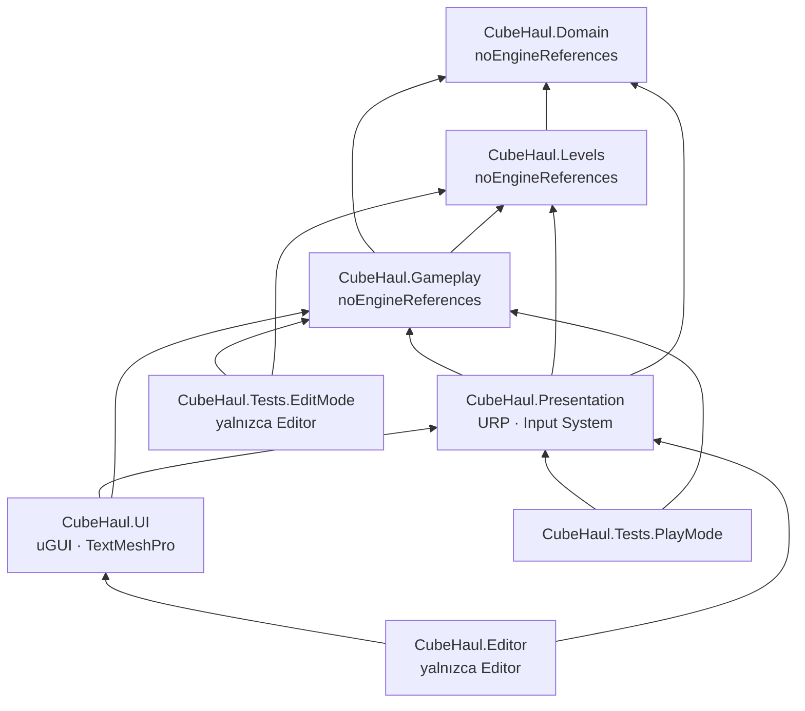

# CubeHaul3D — Unity Projesi ve Test Altyapısı (Görev 05)

| | |
|---|---|
| **Unity** | 6.3 LTS (`6000.3.x`), Universal 3D (URP) |
| **Proje kökü** | Depo kökü (`Assets/`, `Packages/`, `ProjectSettings/`) |
| **Kod kökü** | `Assets/_CubeHaul/` |
| **Platformlar** | Android, iOS |

Depoya bu görevde Unity proje iskeleti eklendi: `Packages/manifest.json`, `ProjectSettings/ProjectVersion.txt`,
`.gitignore`, katman klasörleri, asmdef'ler, örnek kodlar ve EditMode/PlayMode test iskeleti. Unity Editor bu
ortamda yok; editörde yapılacak doğrulama adımları §5'te. Editör olmadan yapılabilen her şey (saf katmanların
derlenmesi, EditMode testlerinin koşması, yapı kuralları) burada `dotnet` ile doğrulandı (§6).

---

## 1. Klasör yapısı

```
Assets/_CubeHaul/
├─ Domain/          CubeHaul.Domain        oyun kuralları (Board, Game …)                saf C#, UnityEngine yok
├─ Levels/
│  ├─ Scripts/      CubeHaul.Levels        bölüm formatı, okuyucu, doğrulayıcı; üretici   saf C#, UnityEngine yok
│  └─ Content/      10 yerleşik bölüm (level-NN-<id>.level.json)
├─ Gameplay/        CubeHaul.Gameplay      oturum, zamanlama, kamyon filosu, güçlendirme  saf C#, UnityEngine yok
├─ Presentation/    CubeHaul.Presentation  3D sahne: MonoBehaviour'lar, URP, giriş, kamera
├─ UI/              CubeHaul.UI            HUD, paneller (uGUI + TextMeshPro)
├─ Editor/          CubeHaul.Editor        editör araçları (yalnızca editörde derlenir)
├─ Tests/
│  ├─ EditMode/     CubeHaul.Tests.EditMode
│  ├─ PlayMode/     CubeHaul.Tests.PlayMode
│  └─ Fixtures/Golden/   TS'den dışa aktarılan referans çıktılar (GOLDEN_FIXTURES.md)
├─ Art/             Materials, Models, Textures, Shaders, Prefabs
└─ Audio/           Music, Sfx
```

Alt çizgili kök (`_CubeHaul`) proje klasörünü Asset Store/üçüncü taraf paketlerinden ayırır ve listenin başında tutar.
Boş klasörler `.gitkeep` ile tutulur; Unity nokta ile başlayan dosyaları yok sayar.

**Önceki planla eşleme** ([PORTING_PLAN §3](PORTING_PLAN.md#3-unity-c-sınıf-mimarisi)):

| Plandaki ad | Şimdiki assembly |
|---|---|
| `CubeHaul.Core` | `CubeHaul.Domain` |
| `CubeHaul.Levels` + `CubeHaul.Data` | `CubeHaul.Levels` (eski `Assets/CubeHaul/Scripts/Data` buraya taşındı, namespace `CubeHaul.Data` → `CubeHaul.Levels`) |
| `CubeHaul.Simulation` | `CubeHaul.Gameplay` |
| `CubeHaul.App` + `CubeHaul.View` | `CubeHaul.Presentation` (3D, önyükleme) ve `CubeHaul.UI` (HUD, paneller) |

Taşınan mevcut dosyalar silinmedi, `git mv` ile geçmişleriyle taşındı: `Assets/CubeHaul/Scripts/Data` →
`Levels/Scripts`, `Assets/CubeHaul/Content/Levels` → `Levels/Content`, `Assets/Tests/Fixtures` → `Tests/Fixtures`.

## 2. Assembly'ler ve bağımlılık kuralları



| Assembly | Başvurur | Platform | Not |
|---|---|---|---|
| `CubeHaul.Domain` | — | hepsi | `noEngineReferences: true` |
| `CubeHaul.Levels` | Domain | hepsi | `noEngineReferences: true` |
| `CubeHaul.Gameplay` | Domain, Levels | hepsi | `noEngineReferences: true` |
| `CubeHaul.Presentation` | Domain, Levels, Gameplay, `Unity.RenderPipelines.Core.Runtime`, `Unity.RenderPipelines.Universal.Runtime`, `Unity.InputSystem` | hepsi | |
| `CubeHaul.UI` | Domain, Levels, Gameplay, Presentation, `UnityEngine.UI`, `Unity.TextMeshPro` | hepsi | |
| `CubeHaul.Editor` | tüm oyun katmanları | Editor | namespace `CubeHaul.EditorTools` (`UnityEditor.Editor` sınıfıyla çakışmasın) |
| `CubeHaul.Tests.EditMode` | Test Runner, Domain, Levels, Gameplay | Editor | `UNITY_INCLUDE_TESTS`, `nunit.framework.dll`, `autoReferenced: false` |
| `CubeHaul.Tests.PlayMode` | Test Runner, Domain, Levels, Gameplay, Presentation | hepsi | aynı test şablonu |

Kurallar (`UnityProjectTests` ile zorlanır):

- Bağımlılıklar yalnızca içe doğrudur: Domain ← Levels ← Gameplay ← Presentation ← UI ← Editor. Ters yön ya da döngü yok.
- Domain, Levels ve Gameplay `noEngineReferences: true`'dur. Kaynaklarında `using UnityEngine/UnityEditor/Unity.*` geçemez,
  derlenmiş assembly'leri hiçbir Unity assembly'sine başvurmaz. Böylece kurallar Unity olmadan derlenir ve test edilir.
- Her asmdef klasöründe en az bir script vardır (Unity boş assembly'yi derlemez, ona başvuranlar uyarı verir).
- Oyun kodu test assembly'lerine başvuramaz (`autoReferenced: false`).

Her assembly'de, ileride büyüyecek küçük ama gerçek bir başlangıç türü var:

| Assembly | Tür | İçerik |
|---|---|---|
| Domain | `Cells`, `GameStatus`, `OpenEdges` | `Cells.Empty = -1`; `Playing / Won / Stuck`; açık kenarlar (Görev 06) |
| Levels | `LevelDefinition`, `PictureDefinition`, `BlockDefinition`, `LevelValidator`, `LevelRepository`, `LevelDefinitionWriter` | Bölüm formatı ve C# veri modeli (Görev 03, 06; [LEVEL_FORMAT §9](LEVEL_FORMAT.md#9-c-veri-modeli-görev-06)) |
| Gameplay | `SimConstants` | `main.ts`'deki zamanlama ve yerleşim sabitleri (kamyon hızı 200, slot aralığı 0.15 s, uçuş 1/3.8 s, 3 rampa şeridi, en fazla 6 slot …) |
| Presentation | `WorldMapper`, `LevelLibrary` | Tasarım alanı (420×900, y aşağı) → dünya (XZ düzlemi; rampa tarafı kameraya yakın, ayna yok); `LevelLibrary` (ScriptableObject) bölüm `TextAsset`'lerini `LevelRepository`'ye verir |
| UI | `DifficultyChipColors` | Easy/Medium/Hard/Expert çip renkleri |
| Editor | `LevelFileValidatorMenu` | **CubeHaul ▸ Validate Level Files**: bölüm dosyalarını oyunun doğrulayıcısıyla denetler |

## 3. Paketler

`Packages/manifest.json`:

| Paket | Sürüm | Neden |
|---|---|---|
| `com.unity.render-pipelines.universal` | 17.3.0 | URP; Unity 6.3 ile gelen sürüm (çekirdek paket, editörle kilitli) |
| `com.unity.test-framework` | 1.5.1 | EditMode/PlayMode testleri |
| `com.unity.ugui` | 2.0.0 | uGUI + TextMeshPro (Unity 6'da tek paket) |
| `com.unity.inputsystem` | 1.14.0 | Dokunmatik giriş |
| `com.unity.ide.rider`, `com.unity.ide.visualstudio` | 3.0.31, 2.0.22 | IDE entegrasyonu |
| `com.unity.modules.*` | 1.0.0 | Yalnızca gerekenler: animation, audio, physics, particlesystem, ui, uielements, androidjni, imageconversion, imgui, jsonserialize, screencapture, umbra, unitywebrequest(+texture), video, accessibility |

Sürüm seçimi hakkında açık not: Unity Editor bu ortamda olmadığı için sürümler projede kurulu editörün paket
listesinden değil, Unity 6.3'ün dağıttığı sürümler bilgisine göre yazıldı. URP ve uGUI çekirdek paketlerdir ve editör
sürümüne kilitlidir; farklı bir yama sürümü kuruluysa Unity bunları ilk açılışta kendisi düzeltir. Test Framework ve
Input System için yazılan sürümler 6.3 ile uyumlu en düşük güvenli sürümlerdir; Package Manager daha yenisini önerirse
güncellenebilir. İlk açılıştan sonra Unity'nin ürettiği `Packages/packages-lock.json` commit edilmelidir (§5).

`ProjectSettings/ProjectVersion.txt` yalnızca `m_EditorVersion: 6000.3.0f1` içerir. Unity Hub, sizde kurulu 6.3
yamasıyla açmayı önerir; açılınca Unity dosyayı kendi sürümüyle yeniden yazar.

## 4. Testler

| Takım | Yer | Ne sınar | Nerede koşar |
|---|---|---|---|
| EditMode | `Tests/EditMode` | Saf katmanların Unity'ye başvurmaması ve bağımlılık yönü; 10 bölüm dosyasının oyunun okuyucusuyla yüklenmesi; `SimConstants` değerleri | Unity Test Runner **ve** `dotnet test` (testler yalnızca NUnit ve saf .NET kullanır) |
| PlayMode | `Tests/PlayMode` | Motorun kare ilerletmesi; `WorldMapper` dönüşümü | Yalnızca Unity |
| Yapı | `Tools/dotnet/CubeHaul.Tests/UnityProjectTests.cs` | Klasörler, asmdef kuralları, paket sürümlerinin tam sabitlenmesi, editör sürümü, `.meta` dosyaları | `dotnet test` |

EditMode testleri proje kökünü çalışma dizininden bulur (`ProjectPaths`). Editörde çalışma dizini proje köküdür,
`dotnet`'te ise derleme klasöründen yukarı çıkılır.

## 5. Unity Editor'de doğrulama adımları

1. **Unity Hub › Add › Add project from disk** ile depo kökünü (`CubeHaul3D/`) seçin. Sürüm sorulursa kurulu
   **6000.3.x** editörünü seçin (aynı küçük sürüm içinde yama farkı sorun değildir).
2. İlk açılışta Unity `Library/`'yi kurar, eksik `ProjectSettings/*.asset` dosyalarını ve `Packages/packages-lock.json`'ı
   üretir. Input System için **"Enable the new input backends?"** sorulursa **Yes** deyin; editör yeniden başlar.
3. **Console** penceresinde derleme hatası olmamalı. Paket sürümüyle ilgili bir uyarı çıkarsa
   **Window ▸ Package Manager**'da önerilen sürüme güncelleyin.
4. **Window ▸ General ▸ Test Runner** › **EditMode** › **Run All**: 76 testin hepsi yeşil olmalı
   (Görev 05'in 9 testi ve Görev 06'nın veri modeli testleri: `NoDataLossTests`, `RealLevelTests`, `DeepCopyTests`,
   `LevelRepositoryTests`, `ErrorReportTests`, `JsonWriterTests`).
5. Aynı pencerede **PlayMode** › **Run All**: 2 test yeşil olmalı.
6. Menüden **CubeHaul ▸ Validate Level Files**: Console'da "all 10 level files are valid" yazmalı.
7. **URP'yi etkinleştirin** (iskelette render pipeline asset'i yok, çünkü bu dosyalar editörde üretilmeli):
   `Assets/_CubeHaul/Art` içinde **Create ▸ Rendering ▸ URP Asset (with Universal Renderer)** → oluşan asset'i
   **Edit ▸ Project Settings ▸ Graphics ▸ Default Render Pipeline** ve **Quality** altındaki her seviyeye atayın.
8. Unity'nin ürettiği/değiştirdiği dosyaları commit edin: `Packages/packages-lock.json`, `ProjectSettings/*.asset`,
   `ProjectVersion.txt`, URP asset'leri ve olası `.meta` güncellemeleri. `Library/`, `Temp/`, `Logs/`, `UserSettings/`
   ve kökteki `.csproj`/`.sln` dosyaları `.gitignore`'dadır.

Komut satırından (CI için) aynı testler:

```bash
Unity -batchmode -nographics -projectPath . -runTests -testPlatform EditMode -testResults TestResults/editmode.xml -logFile -
```

```bash
Unity -batchmode -projectPath . -runTests -testPlatform PlayMode -testResults TestResults/playmode.xml -logFile -
```

(`-runTests` testler bitince editörü kapatır; `-quit` eklenmez. Unity yolu işletim sistemine göre değişir, örn.
macOS'ta `/Applications/Unity/Hub/Editor/6000.3.x/Unity.app/Contents/MacOS/Unity`.)

## 6. Editör olmadan yapılan doğrulama

```bash
cd Tools/dotnet/CubeHaul.Tests && dotnet test
```

```bash
node Tools/unity/metas.mjs --check
```

- `Tools/dotnet/CubeHaul.Domain`, `CubeHaul.Levels`, `CubeHaul.Gameplay`: `Assets` altındaki kaynakları
  `netstandard2.1` + C# 9 ile, **UnityEngine olmadan** derler; proje başvuruları asmdef başvurularıyla aynıdır
  (test edilir).
- `Tools/dotnet/CubeHaul.Tests`: Unity EditMode testlerini (`Assets/_CubeHaul/Tests/EditMode`) aynen derleyip koşturur;
  bölüm formatı, golden fixture ve proje yapısı testleri de buradadır. **259 / 259 geçti**, EditMode'un 76 testi dahil (Görev 06 itibarıyla).
- Presentation, UI, Editor ve PlayMode kodu Unity API'si kullandığı için burada derlenemez. Bu yüzden yalnızca yerleşik,
  uzun süredir değişmeyen API'ler kullanıldı (`Vector3`, `Color32`, `GameObject`, `Time.frameCount`, `MenuItem`,
  `Debug.Log`, `UnityTest`). Kesin doğrulama §5'teki adımlardır.

## 7. `.meta` dosyaları

Her asset ve klasörün `.meta` dosyası commit edilir; böylece GUID'ler her makinede aynıdır ve sahne/prefab
başvuruları kopmaz. Eksik `.meta`'lar `node Tools/unity/metas.mjs` ile üretilir. GUID yoldan türetildiği için bu
çıktı deterministiktir. Var olan `.meta`'lara dokunulmaz; Unity onları sahiplenir. `npm run export:golden` yeni
golden dosyaları için bu adımı kendisi çalıştırır. `--check` eksik ya da sahipsiz `.meta`'yı bildirir.
